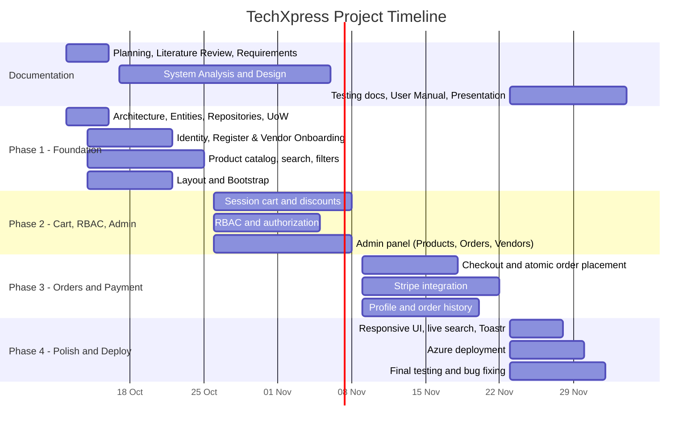

# TechXpress: Project Planning & Management

> Track: Full Stack .NET (DEPI) | Version 1.0 | October 2026

---

## 1. Project Proposal

### 1.1 Overview
TechXpress is an e-commerce web application for selling electronics (laptops, mobiles, cameras, accessories). Customers can browse products, add them to a shopping cart, and pay online through Stripe. Verified vendors can list products, while administrators manage products, categories, orders, and vendor approvals from a central admin panel.

### 1.2 Objective
Build a scalable and maintainable e-commerce platform that applies **N-Tier Architecture**, the **Repository Pattern**, the **Unit of Work Pattern**, and **Dependency Injection** to keep concerns separated while implementing secure vendor verification.

### 1.3 Scope

**In scope**

| Area | Features |
|---|---|
| Catalog | Product listing, search, filters, product details |
| Cart | Session-based cart, totals, promotions/discounts |
| Authentication | Registration, login, roles (Customer, Vendor, Admin) via ASP.NET Identity |
| Authorization | Role-based access control (RBAC) |
| Vendor Onboarding | Submit store details and upload legal documents (National ID, Commercial Register, Tax Card) |
| Vendor Verification | Admin review and approval/rejection workflow for pending vendor requests |
| Orders | Checkout, atomic order placement (save order + reduce stock) |
| Payment | Stripe integration, transaction details stored |
| Profile | Personal details, order history, account settings |
| Admin | Manage products, categories, orders, and vendor verifications using DataTables |
| UI | Bootstrap + custom CSS, responsive, jQuery live search, Toastr notifications |
| Deployment | Microsoft Azure (or Hostinger) |

### 1.4 Technology Stack

| Layer | Technology |
|---|---|
| Presentation | ASP.NET Core MVC, Razor Views, Bootstrap, custom CSS, jQuery, DataTables, Toastr JS |
| Business Logic | C# service classes (TechXpress.Services) |
| Data Access | Entity Framework Core, Repository + Unit of Work (TechXpress.Data) |
| Database | SQL Server (LocalDB for development, Azure SQL for production) |
| Authentication | ASP.NET Core Identity |
| Payment | Stripe |
| Hosting | Microsoft Azure App Service |
| Version Control | Git + GitHub (GitFlow-style: `main`, `develop`, `feature/*`) |

### 1.5 Design Patterns
N-Tier Architecture, Repository Pattern, Unit of Work Pattern, Dependency Injection.

---

## 2. Project Plan

### 2.1 Milestones and Deliverables

| # | Milestone | Deadline | Deliverable |
|---|---|---|---|
| M0 | Planning, Literature Review, Requirements | 16 Oct 2026 | Documents in `docs/01`, `02`, `03` |
| M1 | Core architecture + Auth + Vendor Onboarding + Catalog + Layout | 25 Oct 2026 | Working skeleton, login, vendor document upload, product listing with search/filters |
| M2 | Cart + RBAC + Admin panel & Vendor Approvals | 8 Nov 2026 | Session cart, discounts, role restrictions, DataTables admin with vendor review UI |
| M3 | System Analysis & Design documents | 6 Nov 2026 | All diagrams, wireframes, schema |
| M4 | Checkout + Stripe + Profile | 22 Nov 2026 | Atomic orders, payments, order history |
| M5 | Implementation complete | 30 Nov 2026 | Polished UI, deployed on Azure, README |
| M6 | Testing, reports, presentation | 4 Dec 2026 | Test plan, bug reports, user manual, technical docs, slides |

### 2.2 Gantt Chart

### 2.3 Resource Allocation

| Resource | Details |
|---|---|
| Team | 5 members |
| Tools | Visual Studio 2022, SQL Server LocalDB, Git/GitHub, GitHub Projects (task board) |
| Environments | Local development, Azure (production) |
| Communication | Daily 10-minute stand-up, group chat, pull-request reviews |

### 2.4 Branching Strategy
- `main`: stable releases only (deployed to Azure).
- `develop`: integration branch, the default branch.
- `feature/<name>`: one branch per feature, merged into `develop` through a pull request that needs one review.
- Only the Data Lead creates EF Core migrations, to avoid model-snapshot conflicts.

---

## 3. Task Assignment & Roles

| Member | Role | Responsibilities | Documentation ownership |
|---|---|---|---|
| **1** | Architecture, Data & Deployment (Team Lead) | Solution structure, entities, `DbContext`, migrations, generic/specific repositories, Unit of Work, DI setup, seed data, repository integration tests, Azure deployment, PR reviews | Software Architecture, Technology Stack, Deployment Diagram, Component Diagram, README, Project Plan |
| **2** | Authentication, Authorization, Vendor Onboarding & Profile | ASP.NET Identity (register/login/logout), roles (Customer, Vendor, Admin), RBAC, Access Denied, vendor document submission flow (ID, Commercial Register, Tax Card), profile page, account settings, order history page, CSRF/XSS review | Stakeholder Analysis, Use Case Diagram, User Stories, Security requirements |
| **3** | Product Catalog & Services Testing | `ProductService`, `CategoryService`, product listing, search, filters, product details, jQuery live search, unit tests for services | ER Diagram, Logical & Physical Schema, Class Diagram, Functional Requirements |
| **4** | Cart, Orders & Payment | Session cart, `CartService`, totals and discounts, checkout, `OrderService` with transaction (order + stock), Stripe, storing transaction details | Sequence Diagram (checkout and payment), State Diagram (order status), DFD, Activity Diagram |
| **5** | Admin Panel, UI & QA | Layout, Bootstrap/custom CSS, responsive design, Toastr, Admin area, DataTables for products/categories/orders, test cases and bug tracking | Wireframes and Mockups, UI/UX Guidelines, Test Plan and Test Cases, Bug Reports, User Manual, Presentation |

> Every member also writes the "Technical Documentation" section for their own module and prepares to explain any part of the project in the final discussion.

---

## 4. Risk Assessment & Mitigation Plan

| ID | Risk | Probability | Impact | Mitigation |
|---|---|---|---|---|
| R1 | Merge conflicts in shared files (`Program.cs`, `_Layout.cshtml`) | High | Medium | Feature branches, small PRs, one owner per shared file, pull from `develop` daily |
| R2 | Conflicting EF Core migrations | Medium | High | Only Member 1 creates migrations; entity changes are requested through the lead |
| R3 | Team members with different skill levels | High | Medium | Pair programming, mutual code reviews, simple-first implementation |
| R4 | Stripe integration problems | Medium | High | Start early in test mode, assign to a strong member, keep a fallback "payment pending" flow |
| R5 | Stock inconsistency if order saving fails | Low | High | Single database transaction through Unit of Work, tested with failure scenarios |
| R6 | Security leaks of uploaded vendor legal documents (ID, Commercial Register, Tax Card) | Medium | High | Restrict upload directory access, validate MIME types and extensions, serve files through authorized controller actions |
| R7 | Deployment problems on Azure | Medium | High | Prepare Azure resources early (Phase 3), deploy a test build before the final week |
| R8 | Secrets leaked to GitHub | Medium | High | User Secrets locally, environment variables on Azure, `.gitignore` review |
| R9 | Missing a documentation deadline | Medium | High | Documentation owners assigned per section, weekly documentation check |
| R10 | Member unavailable or delayed | Medium | Medium | Task board visible to all, knowledge sharing, backup owner per module |
| R11 | Scope creep (adding features outside the specification) | Medium | Medium | Scope section in this document is the reference; any addition needs team agreement |
| R12 | Local database setup differs between machines | Medium | Low | LocalDB default in `appsettings.json`, personal overrides in User Secrets, auto-migration on startup |

---

## 5. KPIs (Key Performance Indicators)

| KPI | Target | How to measure |
|---|---|---|
| Page load time (catalog page) | < 3 seconds | Browser dev tools on deployed site |
| Search/filter response time | < 1 second | Manual and logged measurement |
| Successful test-mode payment rate | 100% of valid test cards | Stripe dashboard |
| Order atomicity | 0 orders without stock update | Failure-injection test on `OrderService` |
| Feature completion vs. specification | 100% of listed deliverables | Checklist per week |
| Unit test coverage of services | At least 70% of business logic methods | Test report |
| Critical bugs at delivery | 0 open | Bug report log |
| Uptime of deployed site (week before submission) | >= 99% | Azure monitoring |
| Pull requests reviewed before merge | 100% | GitHub history |
| Documentation items delivered on time | 100% | Deadline tracker |
