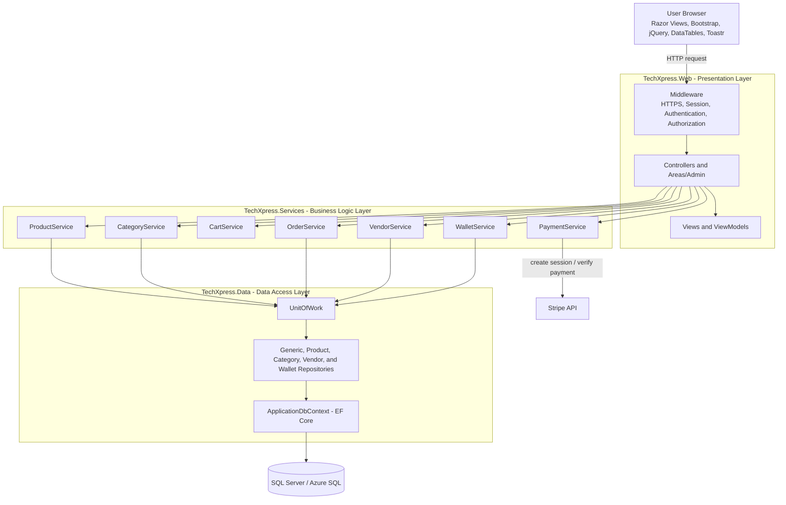
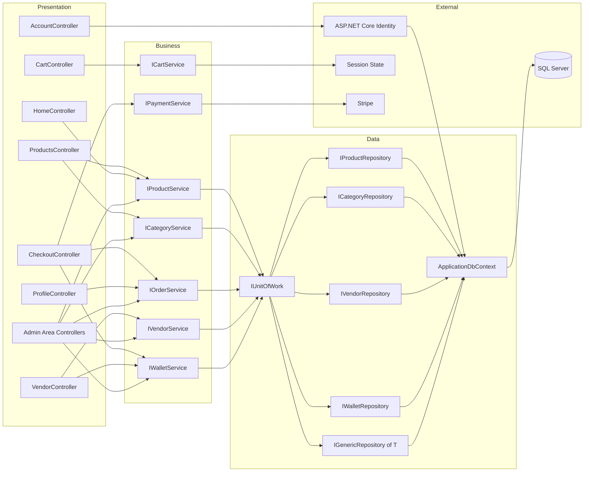
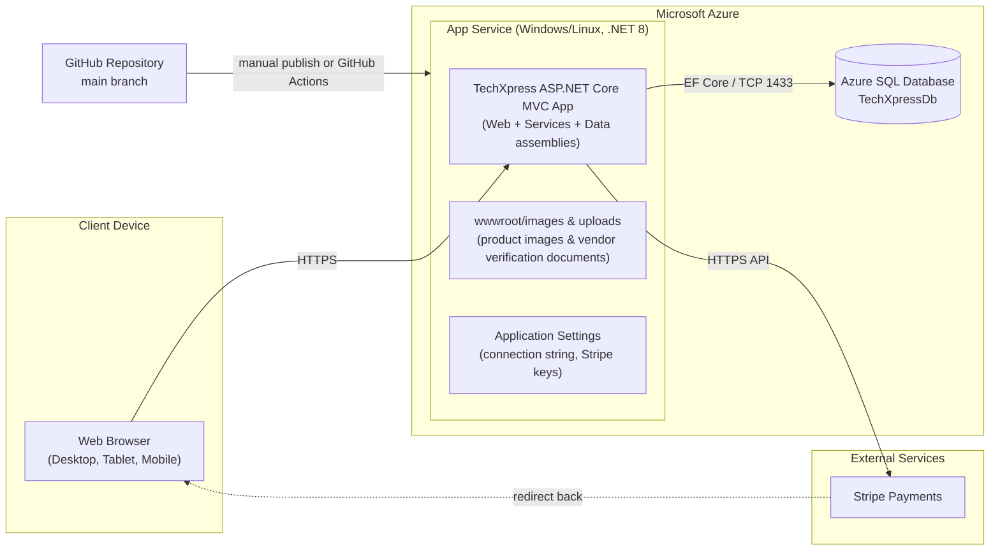

# TechXpress: Problem Statement, Architecture & Deployment

## 1. Problem Statement
Small and medium electronics sellers often rely on social media or manual processes to sell products. This leads to unmanaged stock, lost or duplicated orders, no payment tracking, and no central place to manage the catalog. Furthermore, platforms lack a secure verification process to authenticate vendors (verifying National ID, Commercial Register, and Tax Card) before allowing them to list electronics. 

From a financial perspective, multi-vendor management lacks automated commission calculation and internal ledger tracking, making it difficult for vendors to track their net profits or request payouts from platform administrators safely. Customers cannot easily browse, compare, and pay online with confidence in vendor credibility.

## 2. Objectives
1. Provide an online store where customers can browse, search, and filter electronics.
2. Enable vendor onboarding with mandatory document verification (National ID, Commercial Register, Tax Card) and admin approval.
3. Let customers manage a shopping cart and place orders with secure online payment (Stripe).
4. Automate multi-vendor revenue splitting and platform commission deduction, allocating net funds directly to vendor internal wallets upon successful payment.
5. Provide a transparent financial ledger for vendors to view earnings and submit payout requests (`WalletBalance` and `WalletTransactions`).
6. Guarantee data consistency: an order, stock reduction, and wallet transaction credits are saved atomically.
7. Give administrators a protected panel to manage products, categories, orders, vendor approvals, and payout settlements.
8. Apply N-Tier Architecture, Repository, Unit of Work, and Dependency Injection for a maintainable code base.
9. Deploy the system on Microsoft Azure.

## 3. Software Architecture (N-Tier, MVC)

**Request flow:** `Controller -> Service -> UnitOfWork -> Repository -> DbContext -> SQL Server`.
Controllers never access the database directly; each layer only knows the layer below it.

| Layer | Project | Responsibility |
|---|---|---|
| Presentation | `TechXpress.Web` | Controllers, Views, ViewModels, client-side scripts, authentication & authorization middleware |
| Business Logic | `TechXpress.Services` | Business rules: cart totals, discounts, stock checks, order placement, vendor verification, platform commission calculation, wallet payout processing, payment orchestration |
| Data Access | `TechXpress.Data` | Entities (Product, Vendor, Order, WalletTransaction), DbContext, migrations, repositories, Unit of Work, seed data |

## 4. Component Diagram

## 5. Deployment Diagram

## 6. Technology Stack

| Area | Technology |
|---|---|
| Backend | C#, ASP.NET Core MVC (.NET 8) |
| ORM | Entity Framework Core 8 |
| Authentication | ASP.NET Core Identity |
| Database | SQL Server (LocalDB / SQL Express for development, Azure SQL for production) |
| Financial Ledger | Internal Wallet Transactions (Deposit, Withdrawal), Platform Commission Calculation |
| Frontend | Razor Views, Bootstrap, custom CSS, jQuery, DataTables, Toastr JS |
| Payment | Stripe |
| Cloud | Microsoft Azure (App Service + Azure SQL) |
| Tools | Visual Studio 2022, Git, GitHub |
| Testing | xUnit, Moq, EF Core InMemory/SQLite for repository tests |
