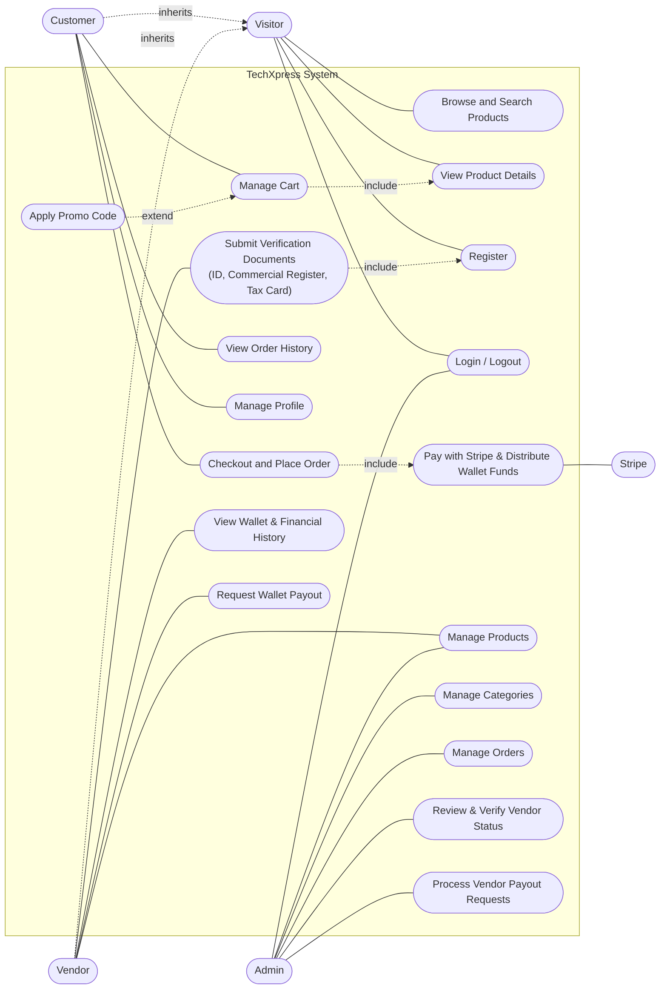

# TechXpress: Use Case Diagram & Descriptions

## 1. Actors

| Actor | Description |
|---|---|
| Visitor | Unauthenticated user; can browse and search products. |
| Customer | Registered user with role `Customer`; can place orders and make payments. |
| Vendor | Registered seller requesting store verification via legal documents; can manage own catalog, view wallet balance, and request payouts. |
| Admin | Store staff with role `Admin`; manages catalog, orders, verifies vendor profiles, and settles vendor payout requests. |
| Stripe | External payment gateway system. |

Customer and Vendor inherit visitor capabilities. Admin manages the store, verifies vendors, and processes financial payouts.

## 2. Use Case Diagram

## 3. Use Case Descriptions

| ID | Use case | Actor | Precondition | Main flow | Postcondition |
|---|---|---|---|---|---|
| UC-01 | Browse and Search Products | Visitor, Customer, Vendor | None | 1. Open the product page. 2. Type a search term and/or choose a category. 3. System shows matching, paginated products. | Filtered list displayed |
| UC-02 | View Product Details | Visitor, Customer, Vendor | Product exists and is active | 1. Click a product. 2. System shows details, price, and stock. | Details displayed |
| UC-03 | Register | Visitor | Not logged in | 1. Open Register. 2. Enter name, email, password. 3. System validates and creates the user. 4. System assigns role Customer and signs the user in. | Account created |
| UC-04 | Login / Logout | Customer, Vendor, Admin | Account exists | 1. Enter email and password. 2. System authenticates. 3. User is redirected (Admin to dashboard, Customer to home). | Authenticated session |
| UC-05 | Manage Cart | Customer | Product has stock | 1. Add product. 2. Change quantity or remove. 3. System recalculates the total. | Cart updated in session |
| UC-05b | Apply Promo Code | Customer | Cart not empty | 1. Enter code. 2. System validates. 3. Discount is applied to the total. | Discount reflected |
| UC-06 | Checkout and Place Order | Customer | Logged in, cart not empty | See Requirements, UC-06 | Order Pending, stock reduced |
| UC-07 | Pay with Stripe & Distribute Wallet Funds | Customer, Stripe | Order Pending | 1. Redirect to Stripe. 2. Customer pays. 3. System verifies payment and marks Order Paid. 4. System calculates platform commission and credits net amount to each vendor's WalletBalance creating a Deposit transaction. | Order Paid, vendor wallets credited|
| UC-08 | View Order History | Customer | Logged in | 1. Open Profile, then Orders. 2. Select an order to see details. | Own orders shown only |
| UC-09 | Manage Profile | Customer | Logged in | 1. Edit details or change password. 2. System validates and saves. | Profile updated |
| UC-10 | Manage Products | Admin, Approved Vendor | Logged in, verified (for Vendor) | 1. Open the products table. 2. Create, edit, or delete a product (with image). 3. System saves and shows a Toastr message. | Catalog updated |
| UC-11 | Manage Categories | Admin | Logged in as Admin | Same as UC-10 for categories; deletion is blocked when the category has products. | Categories updated 
| UC-12 | Manage Orders | Admin | Logged in as Admin | 1. Open the orders table. 2. Open an order. 3. Change status (Shipped, Delivered, Cancelled). | Order status updated |
| UC-13 | Submit Verification Documents | Vendor | Registered as Vendor | 1. Upload National ID, Commercial Register, and Tax Card. 2. Submit for review. |  Status set to Pending |
| UC-14 | Review & Verify Vendor Status | Admin | Logged in as Admin | 1. Open vendor requests. 2. Inspect documents. 3. Approve or Reject with reason. | Vendor status updated |
| UC-15 | View Wallet & Financial History | Approved Vendor | Logged in as Vendor |  1. Open Vendor Dashboard. 2. System displays current `WalletBalance` and ledger table of all deposit/withdrawal transactions. | Financial summary displayed |
| UC-16 | Request Wallet Payout | Approved Vendor | Logged in as Vendor, `WalletBalance` > 0 | . Click "Request Payout". 2. Enter desired amount. 3. System validates amount against available balance. 4. System logs a Withdrawal transaction with status Pending. | Payout request submitted for admin review |
| UC-17 | Process Vendor Payout Requests | Admin | Logged in as Admin | 1. Open Payout Requests tab. 2. Review pending requests and payout details. 3. Confirm manual bank transfer and Approve, or Reject with reason. 4. If approved, system deducts amount from vendor WalletBalance and marks transaction Completed. | Payout settled, vendor balance updated |
