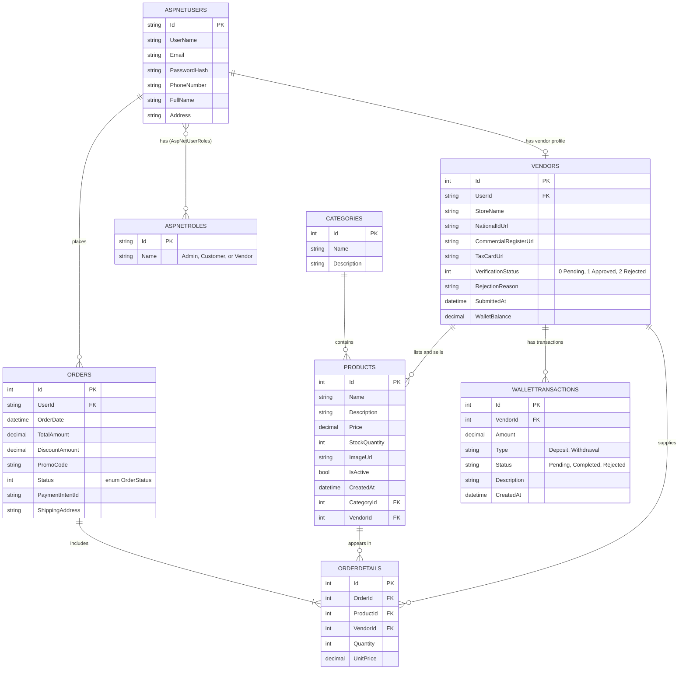
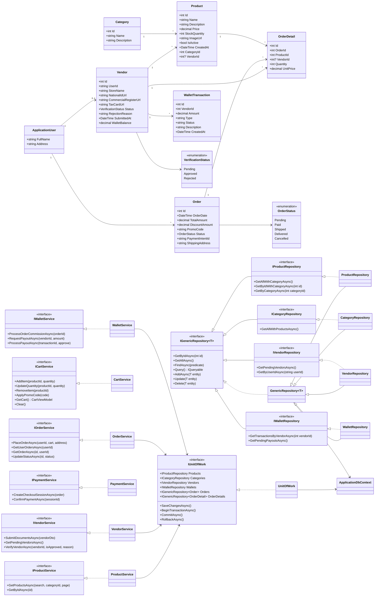

# TechXpress: Database Design & Data Modeling

## 1. ER Diagram

> `DiscountAmount` and `PromoCode` support the promotions requirement (FR-17).WalletBalance and WalletTransactions implement the internal ledger wallet system for vendor earnings and platform commissions.

## 2. Logical Schema (Relational Model)

- **Categories**(<u>Id</u>, Name, Description)
- **Products**(<u>Id</u>, Name, Description, Price, StockQuantity, ImageUrl, IsActive, CreatedAt, CategoryId, VendorId)
- **AspNetUsers**(<u>Id</u>, UserName, Email, PasswordHash, PhoneNumber, FullName, Address, ...)
- **AspNetRoles**(<u>Id</u>, Name)
- **AspNetUserRoles**(<u>*UserId*, *RoleId*</u>)
- **Vendors**(<u>Id</u>, UserId, StoreName, NationalIdUrl, CommercialRegisterUrl, TaxCardUrl, VerificationStatus, RejectionReason, SubmittedAt, WalletBalance)
- **Orders**(<u>Id</u>, *UserId*, OrderDate, TotalAmount, DiscountAmount, PromoCode, Status, PaymentIntentId, ShippingAddress)
- **OrderDetails**(<u>Id</u>, *OrderId*, *ProductId*, VendorId, Quantity, UnitPrice)
- **WalletTransactions**(<u>Id</u>, *VendorId*, Amount, Type, Status,Description, CreatedAt)

(Underlined = primary key, italic = foreign key.)

## 3. Physical Schema (SQL Server)

### Vendors
| Column | Type | Constraints |
|---|---|---|
| Id | int | PK, identity |
| UserId | nvarchar(100) | FK to AspNetUsers(Id), NOT NULL |
| StoreName | nvarchar(150) | NULL |
| NationalIdUrl | nvarchar(max) |NOT NULL |
| CommercialRegisterUrl | nvarchar(max) |NOT NULL |
| TaxCardUrl | nvarchar(max) | NOT NULL |
| VerificationStatus | int | NOT NULL (0 = Pending, 1 = Approved, 2 = Rejected) |
| RejectionReason | nvarchar(max) | NULL |
| SubmittedAt | datetime2 | NOT NULL |
| WalletBalance | decimal(18,2) | NOT NULL, default 0.00 |

### Categories
| Column | Type | Constraints |
|---|---|---|
| Id | int | PK, identity |
| Name | nvarchar(100) | NOT NULL |
| Description | nvarchar(max) | NULL |

### Products
| Column | Type | Constraints |
|---|---|---|
| Id | int | PK, identity |
| Name | nvarchar(200) | NOT NULL |
| Description | nvarchar(max) | NULL |
| Price | decimal(18,2) | NOT NULL |
| StockQuantity | int | NOT NULL |
| ImageUrl | nvarchar(max) | NULL |
| IsActive | bit | NOT NULL, default 1 |
| CreatedAt | datetime2 | NOT NULL |
| CategoryId | int | FK to Categories(Id), ON DELETE RESTRICT |
| VendorId | int | FK to Vendors(Id), NULLable (for system/admin products) |

### Orders
| Column | Type | Constraints |
|---|---|---|
| Id | int | PK, identity |
| UserId | nvarchar(450) | FK to AspNetUsers(Id), NOT NULL |
| OrderDate | datetime2 | NOT NULL |
| TotalAmount | decimal(18,2) | NOT NULL |
| DiscountAmount | decimal(18,2) | NOT NULL, default 0 |
| PromoCode | nvarchar(50) | NULL |
| Status | int | NOT NULL (0 Pending, 1 Paid, 2 Shipped, 3 Delivered, 4 Cancelled) |
| PaymentIntentId | nvarchar(max) | NULL |
| ShippingAddress | nvarchar(max) | NULL |

### OrderDetails
| Column | Type | Constraints |
|---|---|---|
| Id | int | PK, identity |
| OrderId | int | FK to Orders(Id), ON DELETE CASCADE |
| ProductId | int | FK to Products(Id), ON DELETE RESTRICT |
| VendorId | int | FK to Vendors(Id), NULLable |
| Quantity | int | NOT NULL |
| UnitPrice | decimal(18,2) | NOT NULL |

### WalletTransactions
| Column | Type | Constraints |
|---|---|---|
| Id | int | PK, identity |
| VendorId | int | FK to Vendors(Id), ON DELETE RESTRICT |
| Amount | decimal(18,2) | NOT NULL |
| Type | nvarchar(50) | NOT NULL (Deposit, Withdrawal) |
| Status | nvarchar(50) | NOT NULL (Pending, Completed, Rejected) |
| Description | nvarchar(250) | NULL |
| CreatedAt | datetime2 | NOT NULL, default GETUTCDATE() |

### Identity tables
`AspNetUsers`, `AspNetRoles`, `AspNetUserRoles`, `AspNetUserClaims`, `AspNetRoleClaims`, `AspNetUserLogins`, `AspNetUserTokens` are generated by ASP.NET Core Identity. `AspNetUsers` is extended with `FullName` and `Address`.

## 4. Normalization Notes
- All tables are in **3NF**: every non-key attribute depends on the key only.
- `OrderDetails.UnitPrice` intentionally **duplicates** the product price at purchase time so old orders do not change when the price changes (a controlled denormalization).
- `OrderDetails.VendorId` explicitly records the supplying vendor at the moment of order placement to preserve historical revenue attribution even if the product entity is modified or soft-deleted later.
- `Vendors.WalletBalance` and **WalletTransactions** maintain an internal audit ledger for financial calculations, platform commission deductions, and payout request processing.
- The many-to-many relation between users and roles is resolved by `AspNetUserRoles`.
- Delete rules protect history: a category with products and a product with past orders cannot be deleted (use `IsActive = false` instead).

## 5. Class Diagram

