# TechXpress: Data Flow & System Behavior

## 1. DFD Level 0 (Context Diagram)

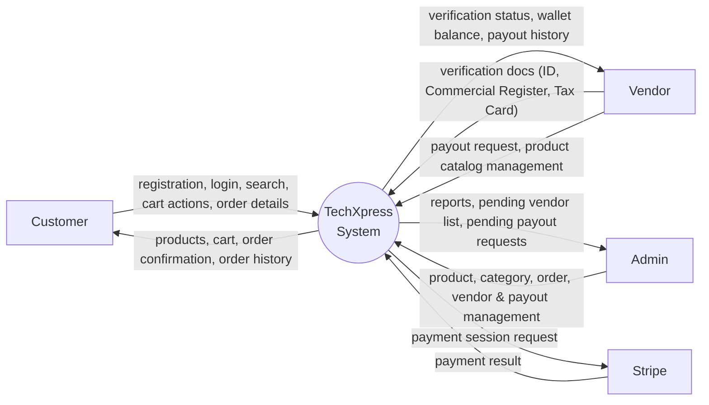

## 2. DFD Level 1

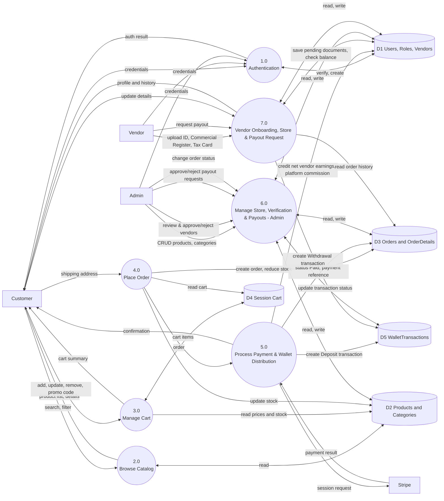

## 3. Sequence Diagrams

### 3.1 Vendor Onboarding & Verification Flow

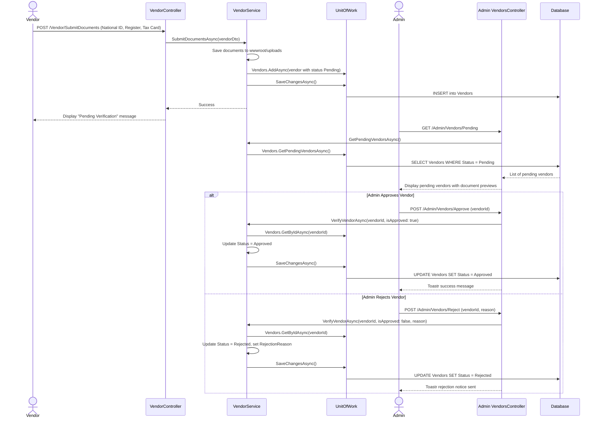

### 3.2 Login

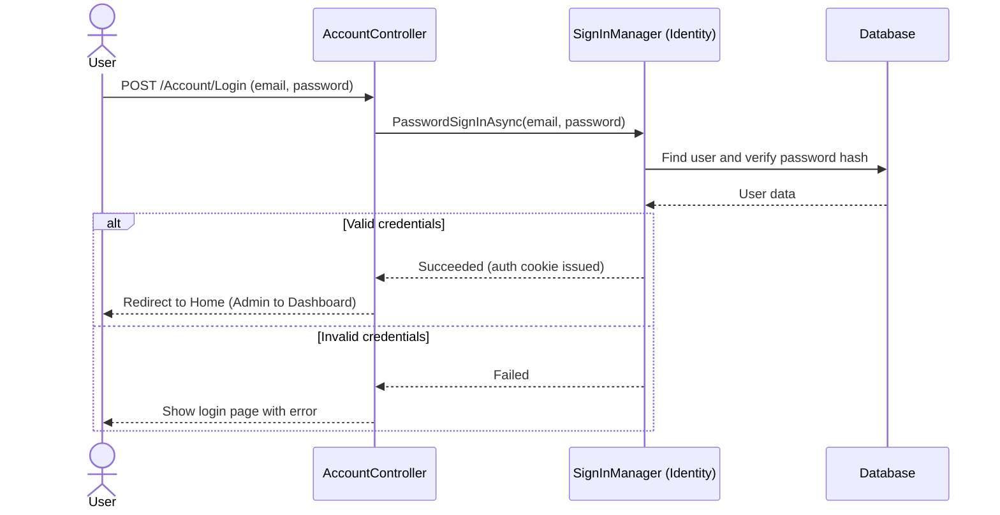

### 3.3 Add to Cart

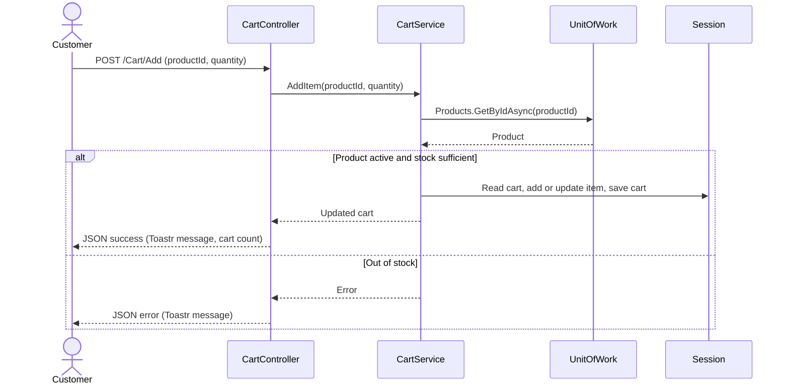

### 3.4 Checkout and Payment, and Commission Allocation

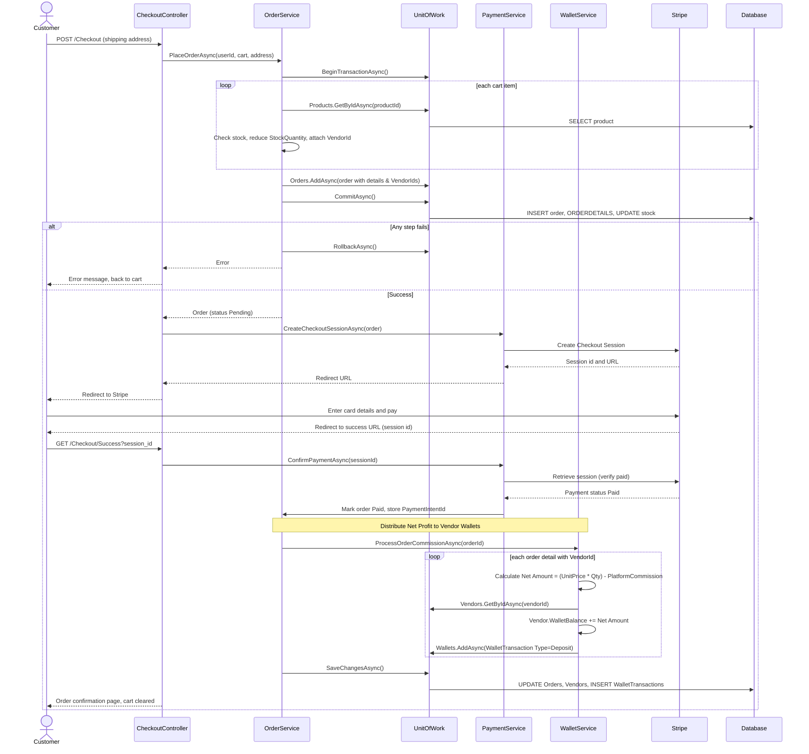

### 3.5 Admin: Update Order Status

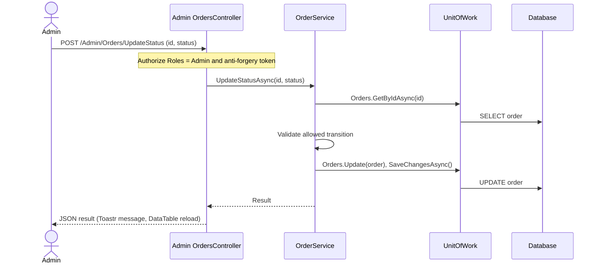

### 3.6 Vendor Payout Request & Admin Settlement Flow

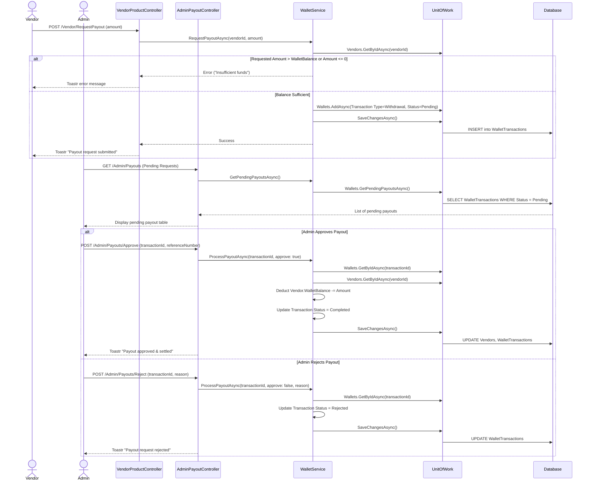
## 4. Activity Diagram: Shopping and Checkout, and Wallet Settlement

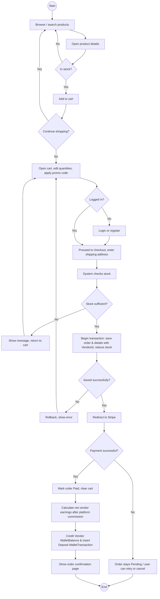

## 5. State Diagram: Vendor Verification Status

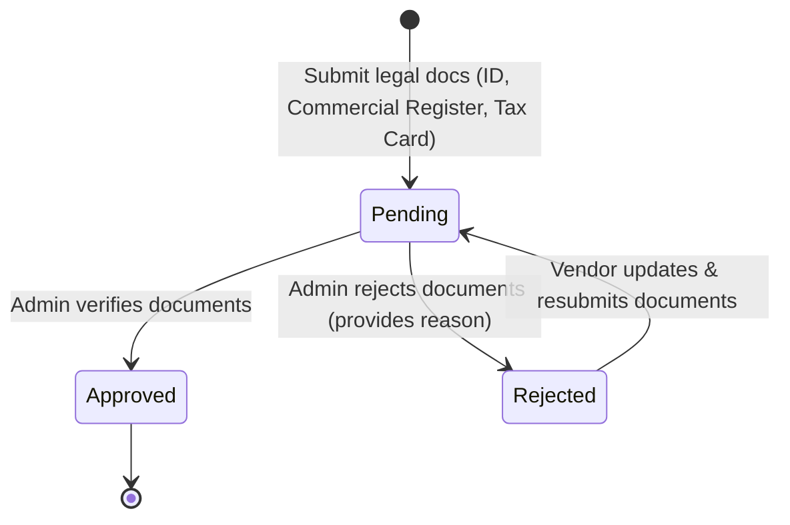

## 6. State Diagram: Order Status

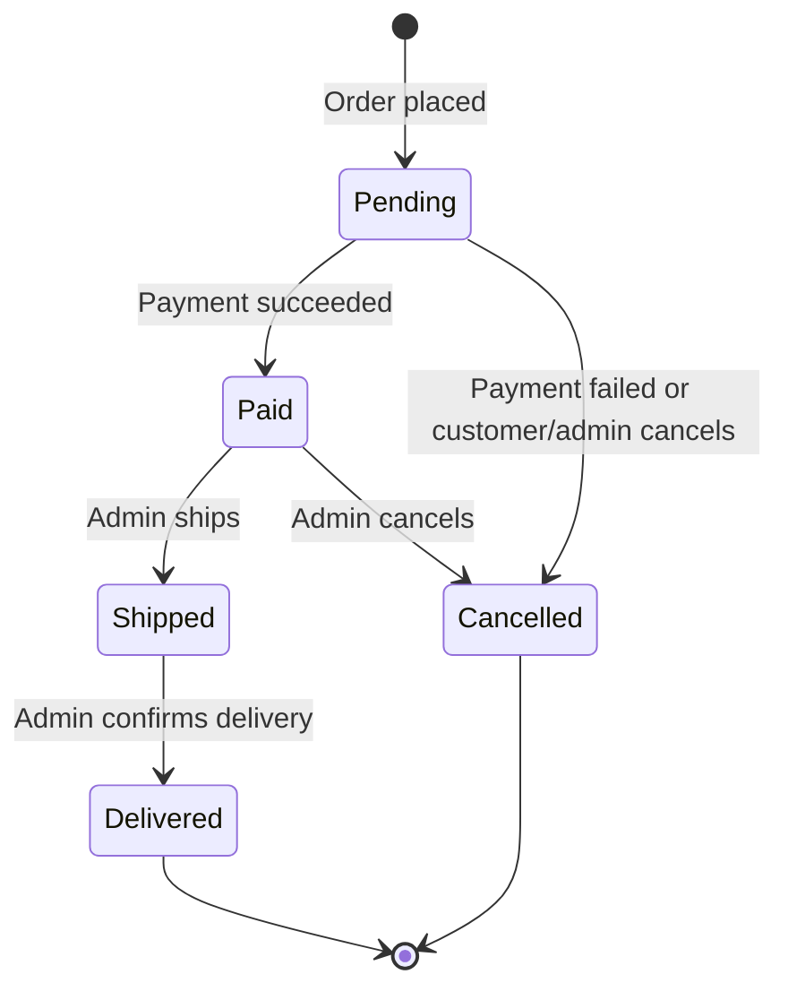

| From | To | Triggered by | Side effect |
|---|---|---|---|
| Pending | Paid | Verified Stripe payment | `PaymentIntentId` stored |
| Pending / Paid | Cancelled | Admin or failed payment | Product stock is restored in the same transaction |
| Paid | Shipped | Admin | None |
| Shipped | Delivered | Admin | None |

Transitions not in the table are rejected by `OrderService`.

## 7. State Diagram: Wallet Transaction & Payout Status

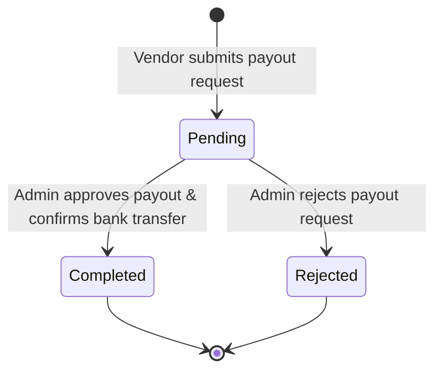

| From | To | Triggered by | Side effect |
|---|---|---|---|
| [*] | Deposit (Completed) | Order payment confirmed | `Vendor.WalletBalance` credited immediately |
| [*] | Pending (Withdrawal) | Vendor requests payout |  Payout request queued for admin review |
| Pending | Completed | Admin approves payout | `Vendor.WalletBalance` debited by requested amount |
| Pending | Rejected | Admin rejects payout | Request marked rejected, wallet balance remains untouched |
