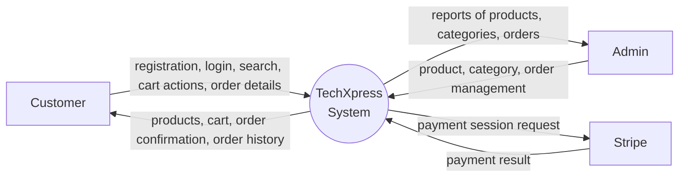
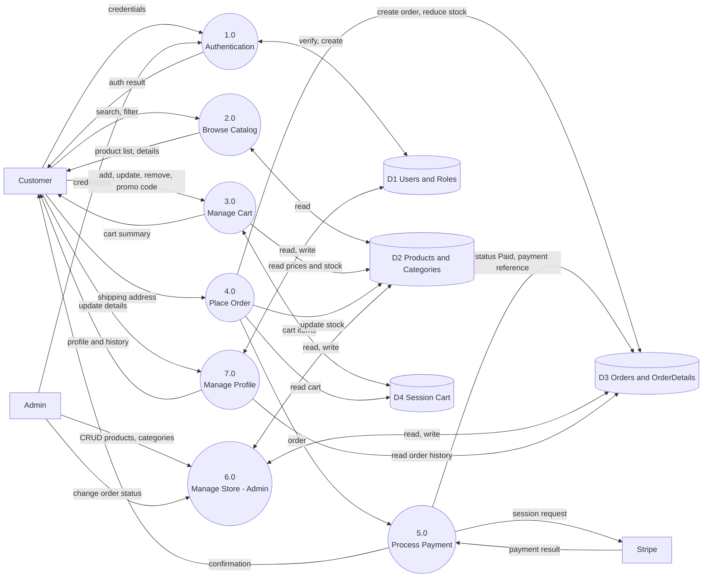
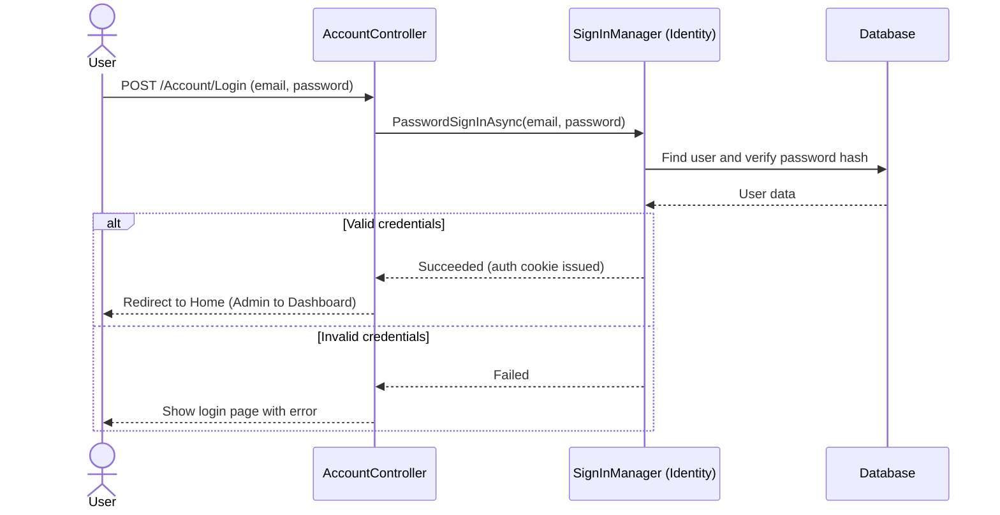
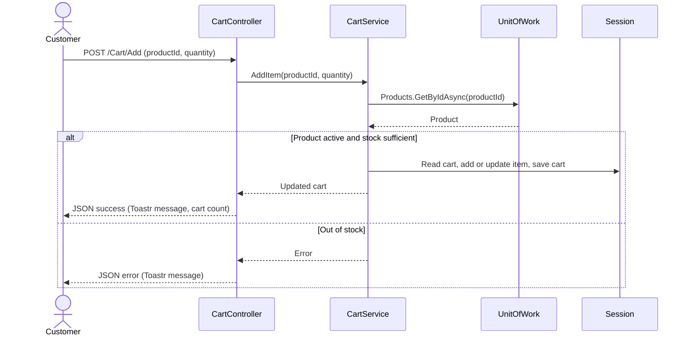
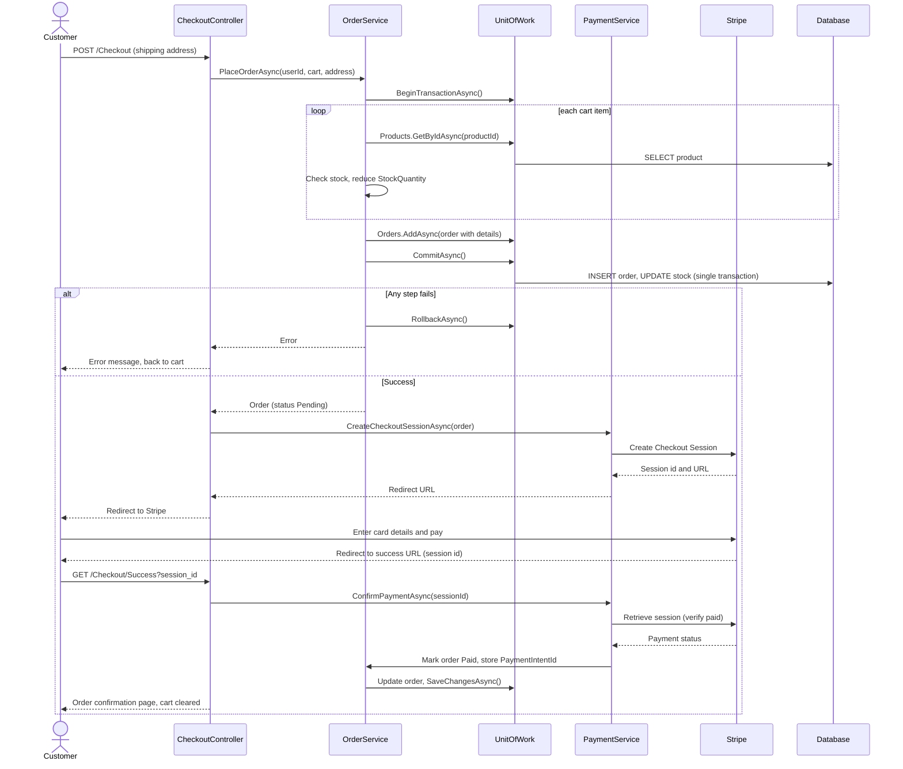
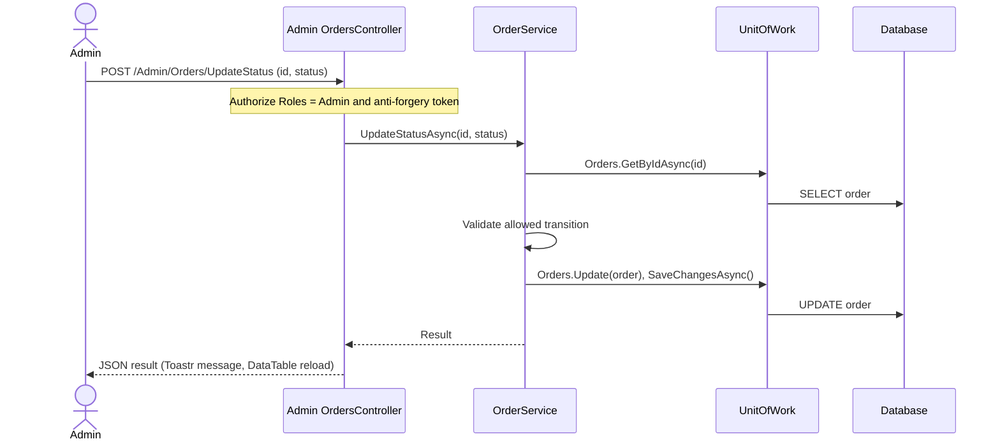
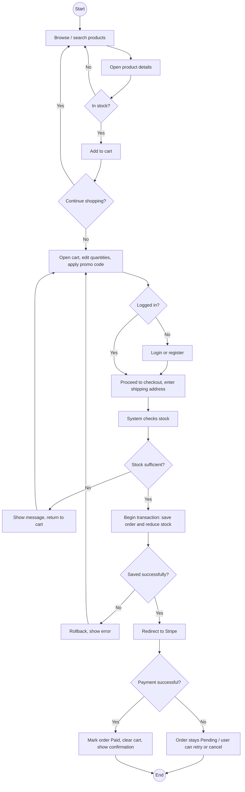
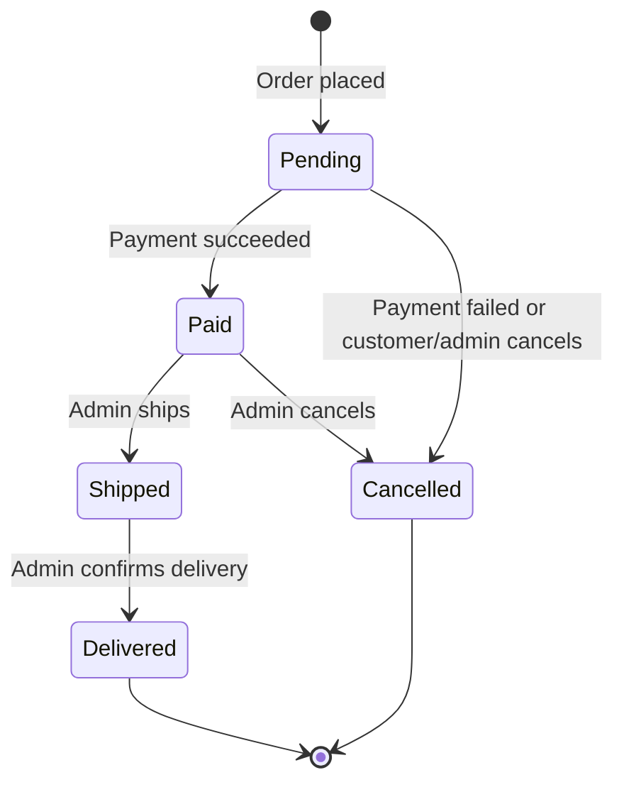

# TechXpress: Data Flow & System Behavior

## 1. DFD Level 0 (Context Diagram)

## 2. DFD Level 1

## 3. Sequence Diagrams

### 3.1 Login

### 3.2 Add to Cart

### 3.3 Checkout and Payment

### 3.4 Admin: Update Order Status

## 4. Activity Diagram: Shopping and Checkout

## 5. State Diagram: Order Status

| From | To | Triggered by | Side effect |
|---|---|---|---|
| Pending | Paid | Verified Stripe payment | `PaymentIntentId` stored |
| Pending / Paid | Cancelled | Admin or failed payment | Product stock is restored in the same transaction |
| Paid | Shipped | Admin | None |
| Shipped | Delivered | Admin | None |

Transitions not in the table are rejected by `OrderService`.
